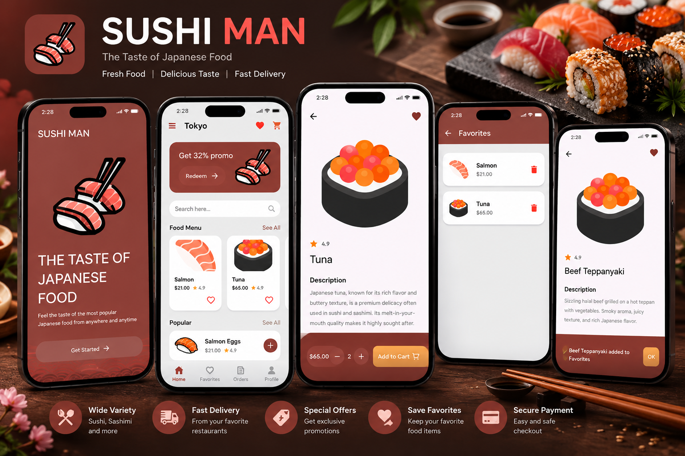

<div align="center">

# 🍣 Sushi Man — Japanese Food Ordering App

### Flutter • Dart • Food Ordering UI

A modern Japanese food ordering application
built with **Flutter and Dart**, featuring
an elegant sushi-inspired design, interactive
food menus, favorites, and shopping cart UI.


</div>

---

## 📸 App Preview

<div align="center">

<a href="1251fe6d-d76a-4bb1-9879-a41f41b5208c.png">
  
</a>

</div>

---

## 📖 About the Project

**Sushi Man** is a Japanese food ordering
application developed with Flutter.

The project focuses on creating an attractive,
responsive, and intuitive mobile shopping
experience inspired by Japanese cuisine.

Users can explore a sushi menu, view detailed
food information, select quantities, add items
to their cart, and save favorite dishes.

The interface uses a warm red color palette,
food illustrations, and clean layouts.

---

## ✨ Key Features

### 🍱 Food Menu

- Browse Japanese food items.
- Explore sushi dishes.
- View food names and prices.
- Display food ratings.
- Promotional offers section.

### 🔍 Food Discovery

- Food search interface.
- Browse menu items.
- Explore featured dishes.
- View individual product details.

### 🍣 Product Details

- Large food illustrations.
- Detailed food descriptions.
- Product pricing.
- Customer rating display.
- Quantity selection controls.

### 🛒 Shopping Cart

- Add to Cart interaction.
- Select item quantities.
- Shopping cart interface.
- Food ordering UI flow.

### ❤️ Favorites

- Add food items to favorites.
- View saved favorite dishes.
- Remove items from favorites.
- Favorite status indicators.

### 🎨 Modern UI/UX

- Custom onboarding screen.
- Sushi-inspired visual identity.
- Modern food product cards.
- Smooth navigation.
- Responsive mobile layouts.
- Custom icons and illustrations.

---

## 📱 Application Screens

| Screen | Description |
|--------|-------------|
| Onboarding | Welcome screen and introduction |
| Home | Promotional offers and food menu |
| Food Details | Product information and quantity controls |
| Favorites | Saved food items |
| Cart | Shopping cart interface |

---

## 🛠️ Technologies Used

| Technology | Purpose |
|------------|---------|
| Flutter | Mobile UI development |
| Dart | Programming language |
| Material Design | UI components |
| Git | Version control |
| GitHub | Source code hosting |

---

## 🏗️ Application Overview

```text
           Sushi Man App
                 |
                 v
          Onboarding Screen
                 |
                 v
             Home Screen
                 |
        +--------+--------+
        |        |        |
        v        v        v
      Search   Menu    Favorites
                 |
                 v
           Food Details
                 |
                 v
         Quantity Selection
                 |
                 v
             Add to Cart
```

---

## 🎨 UI Design

The application uses a Japanese food-inspired
design with:

- Warm burgundy and red tones.
- Clean white and light-gray backgrounds.
- Colorful sushi illustrations.
- Rounded product cards.
- Simple typography.
- Minimal and intuitive navigation.

The goal is to deliver an enjoyable
and visually appealing food browsing
and ordering experience.

---

## 🚀 Getting Started

### Prerequisites

Install the following tools:

- Flutter SDK
- Dart SDK
- Android Studio or VS Code
- Git

### 1. Clone the Repository

```bash
git clone <YOUR_SUSHI_REPOSITORY_URL>
```

Replace the placeholder with your actual
GitHub repository URL.

### 2. Navigate to the Project

```bash
cd <YOUR_PROJECT_FOLDER>
```

### 3. Install Dependencies

```bash
flutter pub get
```

### 4. Run the Application

```bash
flutter run
```

---

## 💡 Development Highlights

This project demonstrates experience in:

- Flutter mobile application development.
- Building food ordering interfaces.
- Creating reusable UI components.
- Managing interactive product screens.
- Implementing favorites interactions.
- Designing shopping cart workflows.
- Creating responsive layouts.
- Developing visually consistent interfaces.

---

## 🎯 Project Goals

- Build an attractive Japanese food application.
- Create a smooth food browsing experience.
- Develop interactive product details.
- Implement shopping cart and favorites UI.
- Practice modern Flutter UI development.

---

## 👨‍💻 Developer

**Ahmed Jaber Ahmed**

Flutter Developer | Mobile App Developer

B.Sc. Computer Science & Artificial Intelligence

📍 Cairo, Egypt

- [GitHub](https://github.com/AhmedJaberAhmed)
- [Portfolio](https://ahmedjaberahmed.github.io/Jaber-website/)
- [LinkedIn](https://www.linkedin.com/in/ahmedjaberahmed/)

---

<div align="center">

### ⭐ Support the Project

If you like this project,
consider giving it a star!

**Made with Flutter 💙**

</div>
